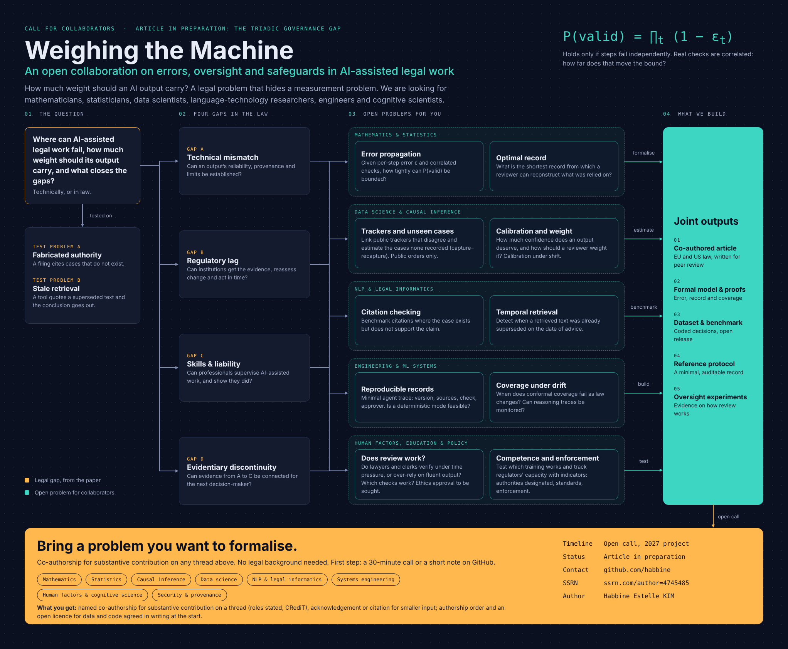

# Weighing the Machine

**An open collaboration on errors, oversight and safeguards in AI-assisted legal work: how much weight should an AI output carry? Open call for collaborators in maths, data science, NLP, engineering and human factors. Co-authorship open.**

Full-size versions: [PNG](call-for-collaborators.png) · [PDF](call-for-collaborators.pdf)

## The question
Where can AI-assisted legal work fail, how much weight should its output carry, and what technical or legal safeguards close the gaps?

The project aims to understand the errors and weaknesses of the whole AI-assisted process, so that it can be overseen, optimised and relied on in proportion, and so that gaps can be filled technically or legally. It starts from two test problems and one concrete requirement: a step must be assessable later by the court, regulator or client that has to decide on it.

Two test problems:
- **Fabricated authority:** a filing cites cases that do not exist.
- **Stale retrieval:** a tool quotes a superseded text and the conclusion goes out.

A legal problem that hides a measurement problem: every unchecked step can fail, and one invalid step can invalidate the whole. If steps fail independently, P(valid) = ∏(1 − ε_t). Real checks are correlated, and how far that changes the bound is open.

## Open problems
Ten threads in five disciplines.

1. **Error propagation** (Mathematics & Statistics): Given a per-step error rate ε and correlated, imperfect checks, how tightly can the probability that an AI-assisted chain of steps is valid be bounded?
2. **Optimal record** (Mathematics & Statistics): What is the shortest record from which a later decision-maker can reconstruct what was relied on?
3. **Trackers and unseen cases** (Data Science & Causal Inference): Public trackers of decisions involving AI-fabricated or unverified content report different totals. Can they be linked, and can the number of cases none of them recorded be estimated?
4. **Calibration and weight** (Data Science & Causal Inference): How much confidence does an AI-assisted output deserve, and how should a reviewer, court or client weight it?
5. **Citation checking** (NLP & Legal Informatics): Benchmark citations where the case exists but does not support the proposition it is cited for.
6. **Temporal retrieval** (NLP & Legal Informatics): Detect when a retrieved text was already superseded on the date advice was given.
7. **Reproducible records** (Engineering & ML Systems): What is the minimal agent trace (version, sources, check, approver) and is a deterministic mode feasible?
8. **Coverage under drift** (Engineering & ML Systems): When does conformal coverage fail as law changes, and how far can reasoning traces be monitored?
9. **Does review work?** (Human Factors, Education & Policy): Do lawyers and clerks really verify AI output under time pressure, or over-rely on fluent output? Which checks and frictions work?
10. **Competence and enforcement** (Human Factors, Education & Policy): Which training approaches actually improve supervision of AI-assisted work, and can regulators' capacity to enforce be tracked with indicators?

## Planned joint outputs
1. A co-authored article (EU and US law, for peer review)
2. A formal model with proofs (error, record, coverage)
3. A dataset and benchmark (coded decisions, open release)
4. A reference protocol (a minimal, auditable record)
5. Oversight experiments (evidence on how review works)

## How to join
No legal background is needed. Start a thread in [Discussions](https://github.com/habbine/reconstructable-ai-decisions/discussions) with your discipline, the problem that interests you and what you would like to formalise, or open an issue. A first step can be a 30-minute call or a short note.

Co-authorship is offered for substantive contribution on a thread. Contributor roles are stated using [CRediT](https://credit.niso.org/); smaller input is acknowledged or cited. Authorship order and licences for data and code are agreed in writing at the start.

## Status
Open call, 2027 project. Article in preparation (*The Triadic Governance Gap*). No deadline.

## Data and confidentiality
Only public decisions and public trackers are used. No confidential or privileged material is collected, and any study with human participants would seek ethics approval first.

## Lead
Habbine Estelle KIM, avocate (Paris and New York bars). [SSRN author page](https://ssrn.com/author=4745485) · [GitHub](https://github.com/habbine)
